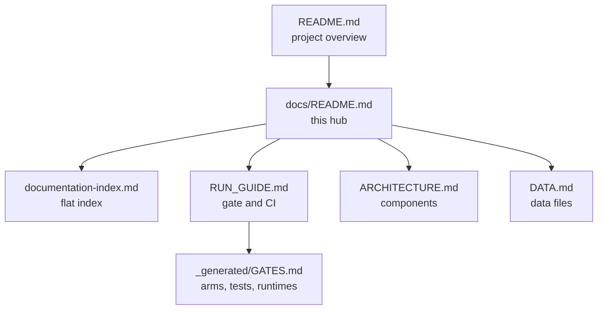

# Garden-of-Iris — Documentation

**Documentation hub.** This is the entry point for the documentation tree; the
flat, complete list of long-lived documents is
[documentation-index.md](documentation-index.md). Start with the
[README](../README.md) for a high-level orientation to the project, an
experimental toolkit for **Iris** — a collective-intelligence language model —
and the data pipeline that supports it.

## Navigation

| Need | Document |
| --- | --- |
| Run the checks (one entry point, one command per arm) | [RUN_GUIDE.md](RUN_GUIDE.md) |
| Understand the components and the data flow | [ARCHITECTURE.md](ARCHITECTURE.md) |
| Know every data file, its columns, and its provenance | [DATA.md](DATA.md) |
| Find any long-lived document | [documentation-index.md](documentation-index.md) |
| Read the current generated facts | [_generated/GATES.md](_generated/GATES.md) |

## Gate and CI in one paragraph

`scripts/gate.py` is the only gate entry point. Its arms are `syntax`, `docs`,
`fast`, `tests`, `models`, and `gnn`; the default arm is `fast`, and CI's job
key `checks` (display name `checks`) runs `syntax`, `docs`, `tests`, and
`models`, while job key `gnn-conformance` (display name
`gnn conformance (pinned)`) runs `gnn`. The GNN pin is
[`.github/gnn-pin.json`](../.github/gnn-pin.json) — schema
`gnn-importer-pin/v1`, `ActiveInferenceInstitute/Generalized_Notation_Notation`
at `v5.0.3` (`8f293d9ba810e6eda5c09842d9c7ed9ffa5f92c1`) — and
[`.github/GNN.md`](../.github/GNN.md) records what the conformance arm parses.
Commands, per-arm prerequisites, and the hosted-CI caveat are in
[RUN_GUIDE.md](RUN_GUIDE.md).

## Evidence rules

Documentation is a view over source-owned facts, not a second place to keep
them.

| Claim type | Authoritative source | Rule |
| --- | --- | --- |
| Commands, defaults, CI steps | `scripts/gate.py`, `.github/workflows/ci.yml` | Run the arm; do not restate a command that the gate defines. |
| Arm runtimes, test counts | [`_generated/GATES.md`](_generated/GATES.md), rendered from the `measure` receipts | `measure --label before\|after` then `report`; never hand-edit a number. |
| The GNN pin | [`.github/gnn-pin.json`](../.github/gnn-pin.json) | Cite the revision from the pin file, not from an older guide. |
| Script behavior, data schemas | The source and [DATA.md](DATA.md) | State explicitly when a script is a non-runnable sketch. |

## Component quick reference

| Script | One-liner |
| --- | --- |
| `discord_bot.py` | Discord bot "Iris": auto-summarizing pools, DM relay, slash commands |
| `hindsight.py` | Hindsight summarization pipeline (daily → weekly → monthly) + training-data construction |
| `parse_fourthought.py` | CLI that parses a URL or PDF into FourThought thought types |
| `iris_apparently.py` | Repaired TensorFlow "DemocraticLLM" transformer sketch (source + temporal embeddings); smoke-tested, not trained |
| `iris_llm.py` | Canonical OpenRouter model client (`chat()` / `complete()`); current `openai` SDK surface |
| `twitter_archive.py` | Converts a Twitter archive export to CSV |
| `text_process.py` | Builds prompt→completion sentence pairs with NLTK |
| `tests/` | Pytest suite for the client, parser, pipeline helpers, and data tools |

## Conventions

- Documentation is written in Markdown (GFM), one space per sentence, tables
  for schemas, and relative links only.
- Data files are documented in [DATA.md](DATA.md) with their exact column names
  as read by the code.
- Claims about script behavior are grounded in the source; when a script is a
  non-runnable sketch (e.g. `iris_apparently.py`), that is stated explicitly in
  [ARCHITECTURE.md](ARCHITECTURE.md) rather than implied.
- Generated numbers live only in [_generated/](_generated/GATES.md); prose links
  there instead of copying a value.
